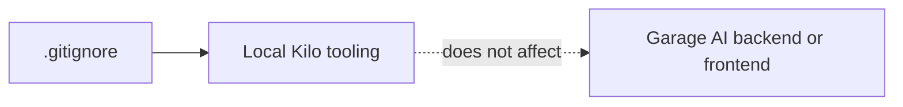
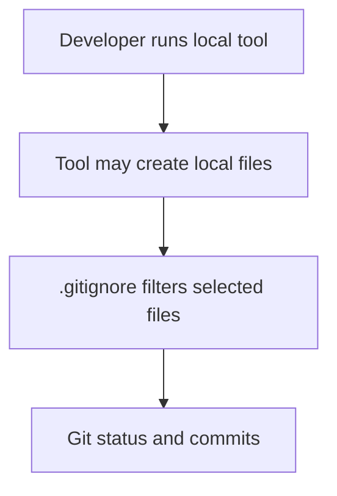

# Kilo configuration folder

This folder contains a tool-specific ignore file. It is not part of the Garage AI runtime.

## Folder tree

```text
.kilo/
├── README.md
└── .gitignore
```

## How the files connect



`.gitignore` lists local Kilo-generated package and manager files that should not be tracked. The application does not import or read this directory.

## Tooling flow



This folder has no connection to Flask, React, LiveKit, or vehicle data.
