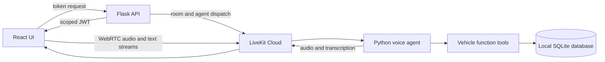

# Garage AI project overview

## What the project does

Garage AI is a browser-based automotive service assistant. The frontend joins a LiveKit room for voice and typed conversation. A Python LiveKit agent responds using speech recognition, a language model, and speech synthesis. The agent can look up or create vehicle profiles using backend tools backed by SQLite.

## Current project tree

See the complete [project tree in the root README](README.md#project-tree). The main runtime files are:

| File | Responsibility |
|---|---|
| `frontend/src/App.jsx` | Connection UI, unique session identity, LiveKit audio, typed chat, live transcript |
| `backend/server.py` | Token API, room validation and setup, agent dispatch |
| `backend/agent.py` | LiveKit worker and voice session pipeline |
| `backend/api.py` | VIN validation and vehicle-profile function tools |
| `backend/db_driver.py` | SQLite table and vehicle record access |
| `backend/prompts.py` | Agent behavior and welcome message |
| `backend/config.py` | Loads project-root environment files |
| `backend/tests/test_server.py` | Mocked token and dispatch endpoint tests |

## Connections and runtime

The browser and backend use Flask only to set up the session. LiveKit carries live audio and text. Vehicle data stays behind agent tools and is never read directly by the frontend.

## Implemented capabilities

- One unique `garage-room-<UUID>` room per browser conversation.
- Flask token endpoint with room/participant validation, agent dispatch, transient retry, and debug mode disabled for its local server.
- LiveKit agent with voice pipeline, prompts, and VIN lookup/create tools.
- SQLite storage for vehicle VIN, make, model, and year.
- Browser microphone/audio connection, connection status, typed chat, spoken transcript display, and disconnect recovery.
- Mocked backend tests plus frontend lint and production build commands.

## Important boundaries

The SQLite database is a local file and is not shared automatically across multiple hosted agent instances. The mock tests do not exercise LiveKit Cloud or provider APIs. See [FUTURE_GOALS.md](FUTURE_GOALS.md) for features and hardening that remain.
