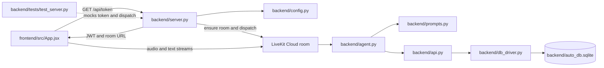
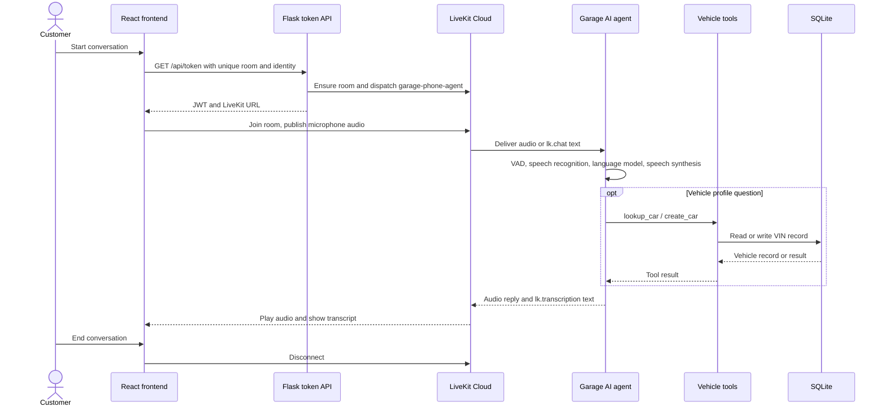

# Garage AI Voice Assistant

Garage AI is a browser-based automotive service assistant. The React frontend supports voice and typed conversation, displays live transcriptions, and joins a LiveKit room. A Flask backend creates participant tokens and dispatches the LiveKit agent. The agent uses vehicle tools backed by a local SQLite database.

## Project tree

```text
AI-VOICE-ASSISTANT/
├── README.md
├── PROJECT_OVERVIEW.md
├── FUTURE_GOALS.md
├── start.ps1
├── .env / .env.local              # Local configuration; never commit secrets
├── .gitignore
├── .kilo/
│   ├── README.md
│   └── .gitignore
├── backend/
│   ├── README.md
│   ├── agent.py
│   ├── api.py
│   ├── config.py
│   ├── db_driver.py
│   ├── prompts.py
│   ├── requirements.txt
│   ├── server.py
│   ├── auto_db.sqlite             # Local vehicle data
│   └── tests/
│       ├── README.md
│       └── test_server.py
└── frontend/
    ├── README.md
    ├── index.html
    ├── package.json
    ├── package-lock.json
    ├── vite.config.js
    ├── BACKEND_INTEGRATION_PHASES.md
    ├── PHASE_1_FRONTEND_VOICE_CONNECTION.md
    ├── PHASE_2_VEHICLE_PROFILES.md
    ├── PRE_PHASE_3_TEXT_CHAT_AND_TRANSCRIPTS.md
    ├── public/
    │   ├── README.md
    │   ├── favicon.svg
    │   └── icons.svg
    └── src/
        ├── README.md
        ├── App.jsx
        ├── App.css
        ├── index.css
        ├── main.jsx
        └── assets/
            ├── README.md
            ├── hero.png
            ├── react.svg
            └── vite.svg
```

The tree omits generated folders such as `.git`, `venv`, `node_modules`, `dist`, and `__pycache__`.

## How the files connect



- `frontend/src/App.jsx` owns the browser conversation UI. It asks the Flask API for a token and joins a unique `garage-room-<UUID>` session.
- `backend/server.py` reads configuration, validates the requested room and participant, creates/dispatches the agent as needed, and returns a scoped JWT. The LiveKit API secret stays on the backend.
- `backend/agent.py` creates the LiveKit voice session and attaches the instruction prompt and vehicle tools.
- `backend/api.py` validates VIN and vehicle details, then delegates storage operations to `backend/db_driver.py`.
- `backend/tests/` verifies the token endpoint with mocked LiveKit API calls; it does not connect to LiveKit Cloud.
- `start.ps1` starts the local Flask service and Vite. It leaves the local agent worker off by default because this project normally uses the LiveKit Cloud production agent.

## How a conversation works



1. Starting a call creates a fresh room name, so reconnects and separate customers do not reuse the same room lifecycle.
2. Flask ensures an agent dispatch before issuing the browser token. The browser never receives LiveKit API credentials.
3. LiveKit carries microphone audio, synthesized agent audio, typed messages (`lk.chat`), and speech transcriptions (`lk.transcription`).
4. If the agent needs a vehicle profile, it calls a backend function tool. The browser never accesses SQLite.
5. Disconnecting unmounts the active conversation UI and clears its in-memory transcript.

## Run locally

Install dependencies once:

```powershell
.\venv\Scripts\python.exe -m pip install -r backend\requirements.txt
Set-Location frontend
npm ci
```

Put LiveKit and speech-provider credentials in the project-root `.env.local` (or `.env`). Do not put server secrets in frontend environment variables or commit them.

Start the project using the default launcher:

```powershell
Set-Location ..
.\start.ps1
```

Or run the services in separate terminals:

```powershell
.\venv\Scripts\python.exe backend\server.py
```

```powershell
Set-Location frontend
npm run dev
```

Open the Vite URL shown in the terminal. Flask is an API service; its `/` page is not the frontend. For the LiveKit Cloud production agent, do not start `backend/agent.py dev` alongside it. `start.ps1 -RunLocalAgent` is available only when intentionally running a local worker.

## Verify changes

From the repository root:

```powershell
.\venv\Scripts\python.exe -m unittest discover -s backend\tests -v
Set-Location frontend
npm run lint
npm run build
```

See [PROJECT_OVERVIEW.md](PROJECT_OVERVIEW.md) for component details and [FUTURE_GOALS.md](FUTURE_GOALS.md) for planned work and current gaps.
