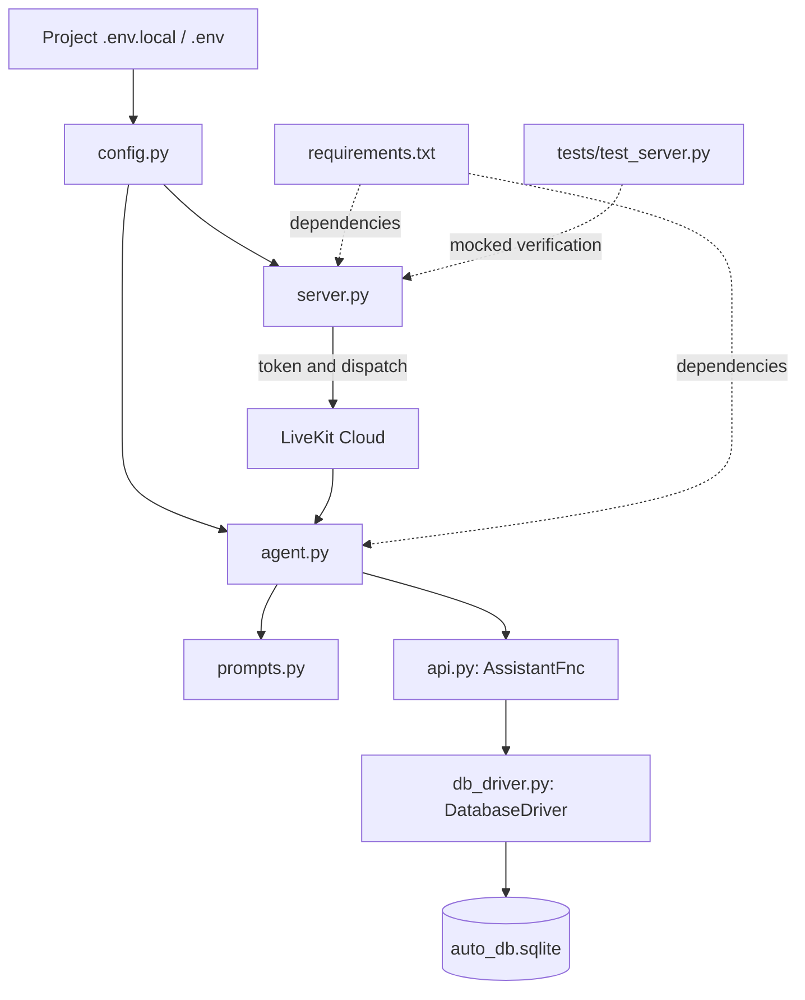
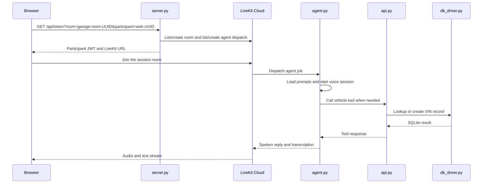

# Backend

The backend issues LiveKit browser tokens, dispatches the Garage AI worker, runs the voice agent, and implements vehicle-profile tools backed by SQLite.

## Folder tree

```text
backend/
├── README.md
├── agent.py
├── api.py
├── config.py
├── db_driver.py
├── prompts.py
├── requirements.txt
├── server.py
├── auto_db.sqlite
└── tests/
    ├── README.md
    └── test_server.py
```

`auto_db.sqlite` is the local SQLite data file created by `db_driver.py`. It is runtime data, not Python source.

## How the files connect



- `config.py` loads project-root `.env.local` and `.env` files for both the API and worker.
- `server.py` exposes `GET /api/token`, validates the session room/participant, ensures the room and `garage-phone-agent` dispatch are ready, then returns a JWT and LiveKit URL.
- `agent.py` is the LiveKit worker entry point. It creates the voice session, enables the configured VAD/STT/LLM/TTS pipeline, and supplies tools from `api.py`.
- `prompts.py` defines the agent instructions and opening message.
- `api.py` defines LiveKit function tools for looking up and creating vehicle profiles.
- `db_driver.py` manages the SQLite connection and `cars` table.
- `requirements.txt` lists Python dependencies; `tests/test_server.py` tests the token/dispatch path using mocks.

## Backend runtime diagram



The token API only coordinates session setup. Real-time media and text travel through LiveKit; vehicle data operations remain in the agent's backend tools.

## Run and test

From the project root, start the API with `..` not required; run:

```powershell
.\venv\Scripts\python.exe backend\server.py
```

Run mocked token API tests with:

```powershell
.\venv\Scripts\python.exe -m unittest discover -s backend\tests -v
```

The local server binds to `127.0.0.1` with Flask debug mode disabled. For a production deployment, use a production WSGI server and shared/durable storage appropriate to the deployment.
