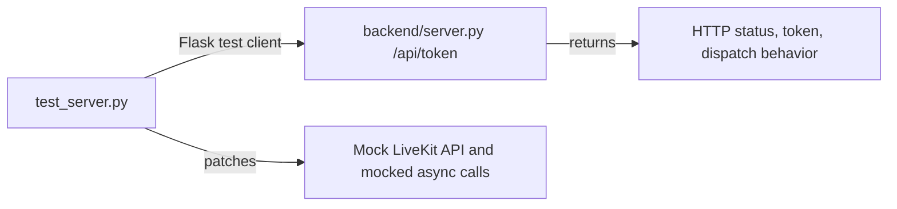
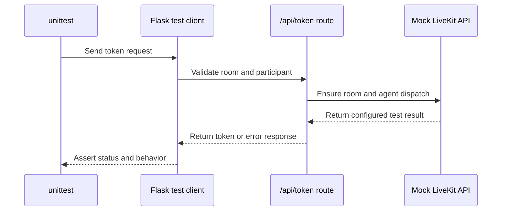

# Backend tests

This folder contains focused unit tests for the Flask LiveKit token endpoint.

## Folder tree

```text
backend/tests/
├── README.md
└── test_server.py
```

## How the files connect



`test_server.py` imports the backend server and exercises its Flask route. LiveKit room and dispatch methods are mocked so the suite does not need a LiveKit Cloud connection or real credentials.

## Test flow



The tests cover first-time room/dispatch creation, reuse of pending dispatches, replacement of terminal dispatches, rejection of invalid room names, one retry for transient failures, no retry for permanent failures, and same-process concurrent requests.

Run from the repository root:

```powershell
.\venv\Scripts\python.exe -m unittest discover -s backend\tests -v
```

These tests do not verify the external LiveKit Cloud agent, provider credentials, microphone permissions, database tools, or browser UI. Those need separate integration checks.
