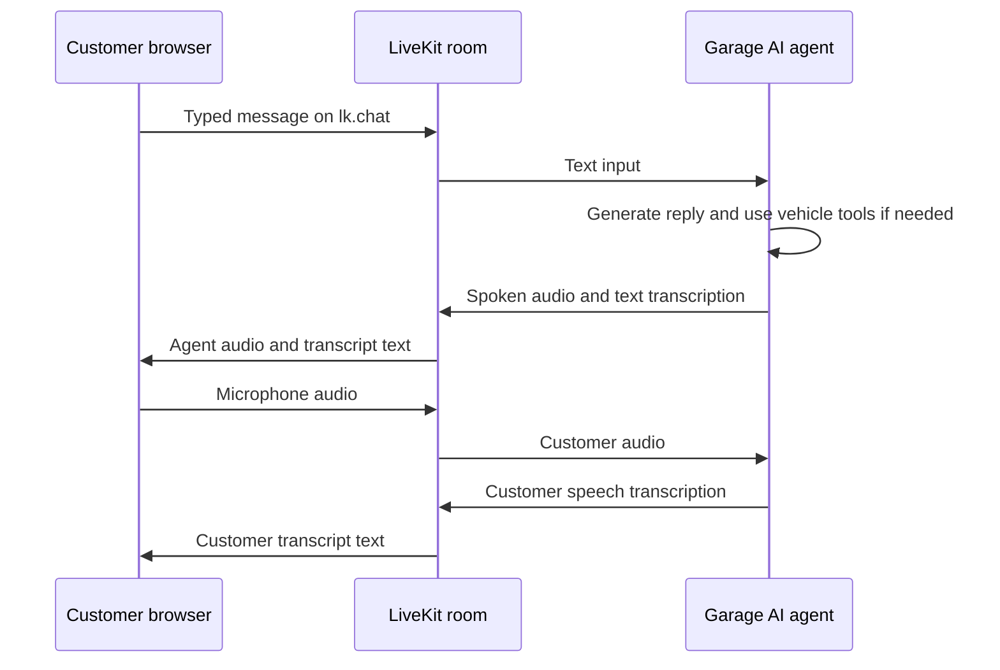

# Phases A–C — Typed Chat and Live Transcripts

> **Status: implemented.** The composer, `lk.chat` sending, `lk.transcription` display, chronological transcript, thinking state, and session cleanup are in `src/App.jsx`. This document records their design and acceptance criteria. Agent avatar and video work remain future work.

## Purpose

Before adding an agent avatar or customer video, add a text conversation surface to the existing voice UI. Customers should be able to type and send a message, while the screen also shows what the customer says aloud and what Garage AI says aloud.

This is a LiveKit room feature. Flask remains responsible for issuing the room token and dispatching the agent. The browser sends and receives text through LiveKit; it does not call the vehicle database directly.

## Implemented starting point

- Phase 1 connects the React frontend to a unique `garage-room-<uuid>` session, publishes microphone audio, plays agent audio, and shows connection state.
- Phase 2 attaches vehicle lookup and profile creation tools to the backend agent.
- The frontend now has a typed message composer and a live transcript for typed and spoken turns.
- `AgentSession` handles input and output through LiveKit text streams using the installed SDK defaults.

## Message flow

## Phase A — Send typed messages

1. Add a multiline message composer and Send button to the connected conversation UI.
2. Get the active LiveKit `Room` from the existing `LiveKitRoom` context.
3. On submit, trim the message, reject empty input, and send it with `room.localParticipant.sendText(message, { topic: 'lk.chat' })`.
4. Keep the existing microphone enabled. Typed and spoken inputs use the same LiveKit room and agent session.
5. Show sending/failure feedback. If sending fails, preserve the typed draft so the customer can retry.
6. Keep the user message visible immediately and reconcile it with any server-delivered copy using its stream ID to avoid duplicates.

The agent's default text-input handler consumes `lk.chat` messages and generates a response. The message should enter the same `AgentSession` conversation context as voice turns, so Phase 2 vehicle tools remain available to typed requests as well.

## Phase B — Show spoken conversation text

1. Subscribe to the `lk.transcription` text stream while the room is connected.
2. Render user speech transcription segments as customer messages and agent speech transcriptions as Garage AI messages.
3. Update an existing message as interim transcription chunks arrive; mark it final when the stream indicates a final segment. Use the stream/segment identifiers to update messages instead of appending duplicate rows.
4. Keep the transcript scrolled to the newest message unless the customer has scrolled upward to read earlier turns.
5. Retain the existing audio renderer and connection states. The transcript supplements audio; it does not replace spoken responses.

LiveKit AgentSession sends speech transcriptions on `lk.transcription` by default. Prefer text-stream handling or the React text-stream hook. The older `TranscriptionReceived` room event is deprecated and should not be the foundation for this feature.

## Phase C — Make typed and voice turns feel like one conversation

- Use one chronological transcript for spoken user input, typed user input, and agent replies.
- Label messages by sender and distinguish typed turns from speech if it improves clarity.
- Show a “Garage AI is thinking” indicator while the agent processes either kind of input.
- If the user submits text while the agent is speaking, use LiveKit's normal text-input behavior to interrupt and process the new turn; keep the display consistent with the actual session behavior.
- Clear the composer after a successful send, not before.
- Clear in-memory transcript state when the user disconnects or starts a new session.

## Backend changes expected

The backend should need little or no custom chat code:

- Keep `AgentSession` as the shared voice and text conversation manager.
- Verify that text input and transcription output are enabled for `RoomIO` in the installed LiveKit Agents version. Set explicit room options only if needed for reliable behavior.
- Do not add a separate Flask chat endpoint. Sending prompts through Flask would create a second conversation path and would bypass the active LiveKit session and its tools.
- Do not send VIN database reads or writes from the browser. The existing agent tools remain the only vehicle-data path.

## Acceptance criteria

- A typed message reaches the connected agent and receives the agent's normal response, including spoken audio.
- Customer speech appears as text in the transcript.
- The agent's spoken reply appears as text in the transcript and stays paired with its audio response.
- Typed and spoken turns share conversation context; for example, a typed VIN can be looked up by the Phase 2 tool.
- Interim text updates in place and final text does not appear twice.
- Send failure preserves the customer's draft; disconnect clears the session transcript.
- Audio-only use remains available if the customer never types.

## Scope and privacy

- This is a live session transcript, not a message-history service. LiveKit text streams are real-time transport and do not provide long-term persistence. The frontend can keep messages in memory for the current session; persistence requires a separate product decision.
- VINs and other vehicle details may appear on screen during the session. Do not add browser storage or transcript logging by default.
- Video/avatar work remains out of scope until this feature is implemented and confirmed.

## Completed implementation order

1. Added the composer and send through `lk.chat`.
2. Subscribed to `lk.transcription` and displayed customer and agent speech.
3. Combined typed and spoken turns into one in-memory transcript, including partial/final updates and error handling.
4. Added thinking, send-failure, scroll, and disconnect behavior.
5. Next, choose the avatar or video direction described in `BACKEND_INTEGRATION_PHASES.md` and `FUTURE_GOALS.md`.

## LiveKit references

- [Text and transcriptions for Agents](https://docs.livekit.io/agents/multimodality/text/)
- [LiveKit text streams](https://docs.livekit.io/transport/data/text-streams/)
- [React chat components](https://docs.livekit.io/frontends/agents-ui/chat/)
