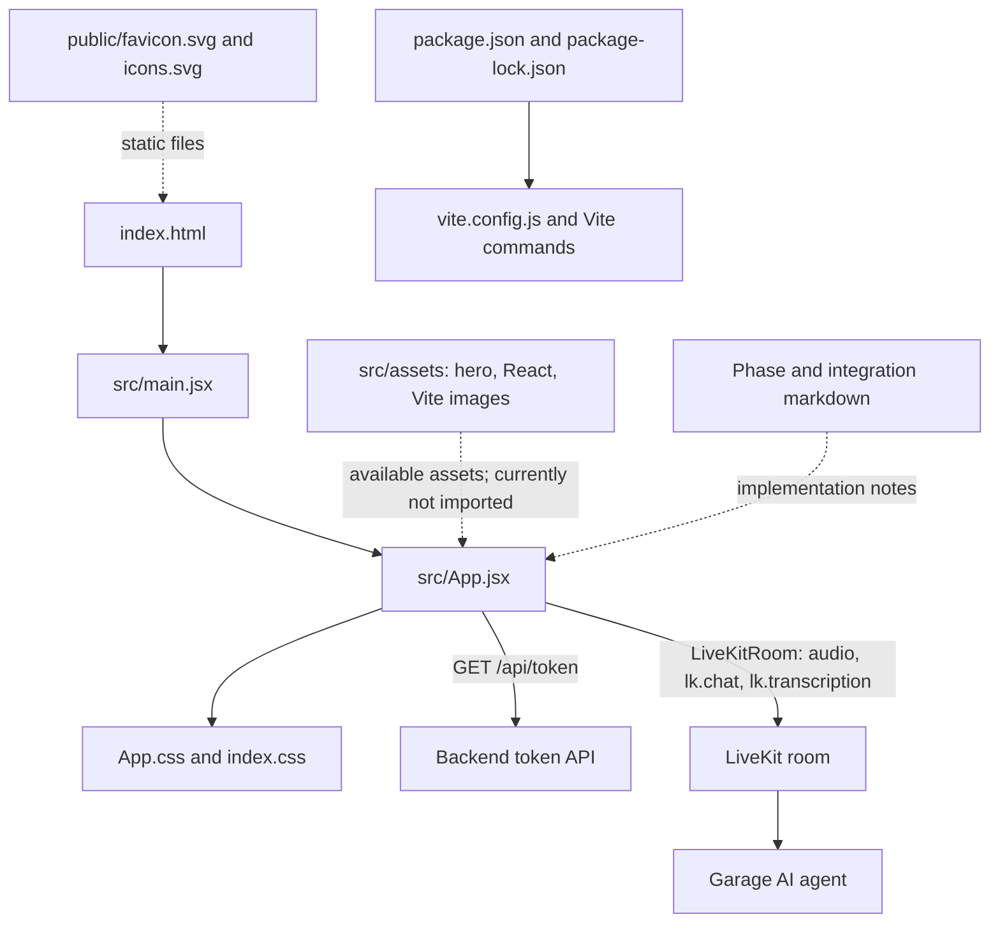
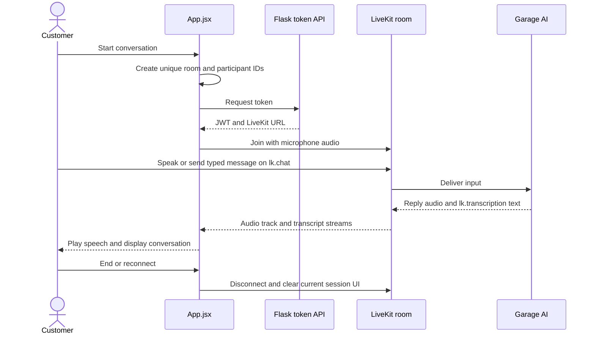

# Frontend

The frontend is a React and JavaScript single-page application built with Vite. It connects to the Flask token API, joins LiveKit, publishes microphone audio, sends typed messages, and displays spoken transcriptions and agent state.

## Folder tree

```text
frontend/
├── README.md
├── index.html
├── package.json
├── package-lock.json
├── vite.config.js
├── BACKEND_INTEGRATION_PHASES.md
├── PHASE_1_FRONTEND_VOICE_CONNECTION.md
├── PHASE_2_VEHICLE_PROFILES.md
├── PRE_PHASE_3_TEXT_CHAT_AND_TRANSCRIPTS.md
├── public/
│   ├── README.md
│   ├── favicon.svg
│   └── icons.svg
└── src/
    ├── README.md
    ├── App.jsx
    ├── App.css
    ├── index.css
    ├── main.jsx
    └── assets/
        ├── README.md
        ├── hero.png
        ├── react.svg
        └── vite.svg
```

## How the files connect



- `index.html` supplies the page root and loads `src/main.jsx`.
- `main.jsx` mounts `App.jsx` inside React Strict Mode and loads global CSS.
- `App.jsx` controls connection lifecycle, conversation status, typed messages, transcriptions, and LiveKit audio.
- `App.css` styles the assistant and conversation UI; `index.css` provides global styles.
- Vite serves `public/` files directly and bundles imported source files under `src/`.
- The phase documents record integration and feature requirements. [FUTURE_GOALS.md](../FUTURE_GOALS.md) is the current list of not-yet-implemented work.

## Frontend conversation diagram



Typed and spoken turns share the active LiveKit session. The frontend does not connect to SQLite and does not contain LiveKit API secrets.

## Run and verify

```powershell
npm ci
npm run dev
```

Set `VITE_TOKEN_API_URL` only when the Flask API is not at its local default (`http://127.0.0.1:5000`). Do not put LiveKit API keys or secrets in Vite environment variables.

Useful checks:

```powershell
npm run lint
npm run build
```
