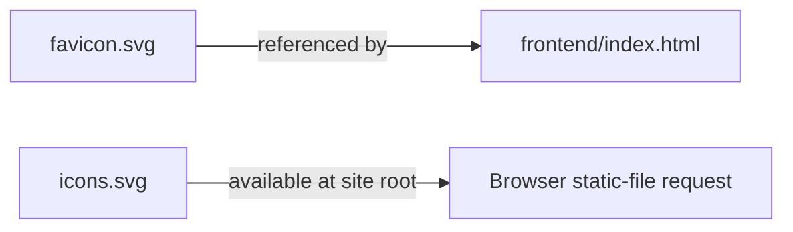
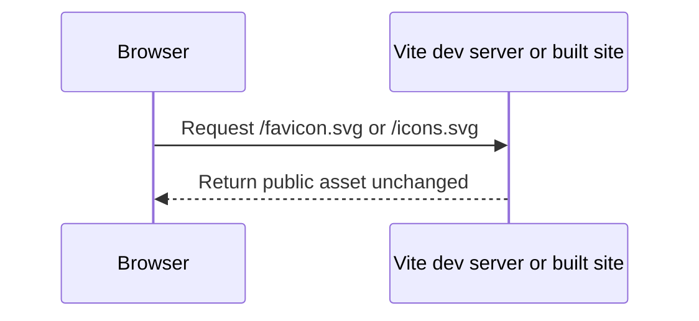

# Frontend public files

Vite copies files in `public/` to the site output without bundling or renaming them.

## Folder tree

```text
frontend/public/
├── README.md
├── favicon.svg
└── icons.svg
```

## How the files connect



`favicon.svg` is referenced by `index.html`. `icons.svg` is available as a static resource; it is not currently imported by the React application.

## Static-file flow



These files are presentation assets. They do not participate in token creation, LiveKit media, or agent processing.
