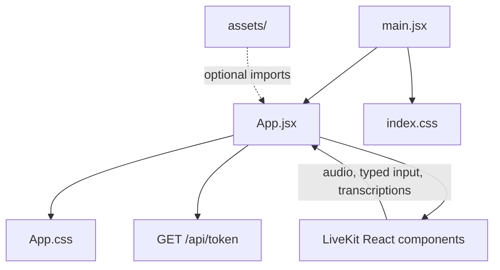
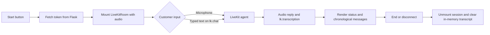

# Frontend source

This folder contains the React application entry point, conversation UI, and styles.

## Folder tree

```text
frontend/src/
├── README.md
├── App.jsx
├── App.css
├── index.css
├── main.jsx
└── assets/
    ├── README.md
    ├── hero.png
    ├── react.svg
    └── vite.svg
```

## How the files connect



- `main.jsx` mounts the app into the `#root` element from `frontend/index.html`.
- `App.jsx` owns token fetching, unique room/participant IDs, LiveKit connection, audio playback, typed chat, transcript rendering, and disconnect cleanup.
- `App.css` styles the page-level application and conversation components.
- `index.css` defines global document and typography styles.
- `assets/` holds image files. The current application does not import these starter assets.

## Runtime flow



The backend manages credentials and agent dispatch. This source folder handles the browser interaction and real-time UI only.
