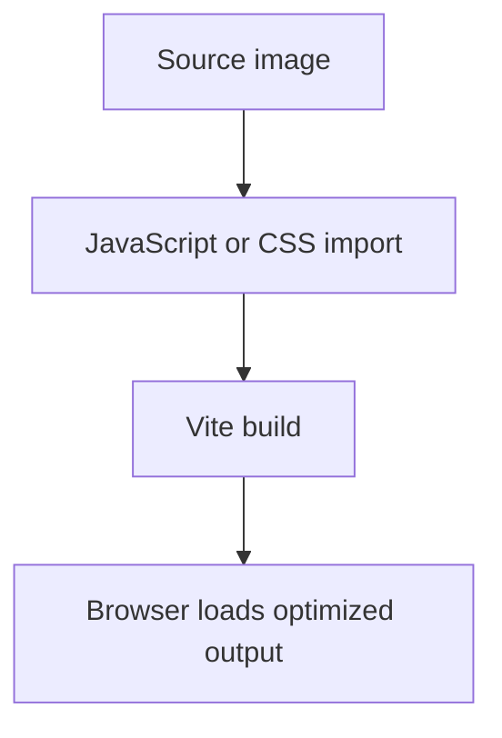

# Frontend source assets

This folder contains image assets that can be imported by the React source code.

## Folder tree

```text
frontend/src/assets/
├── README.md
├── hero.png
├── react.svg
└── vite.svg
```

## How the files connect


The current application does not import these images. They are retained starter/example assets and can be removed once confirmed unnecessary, or imported when a feature needs them.

## Asset flow



No backend or LiveKit service reads this folder. Only assets explicitly referenced by frontend code become part of the bundled experience.
